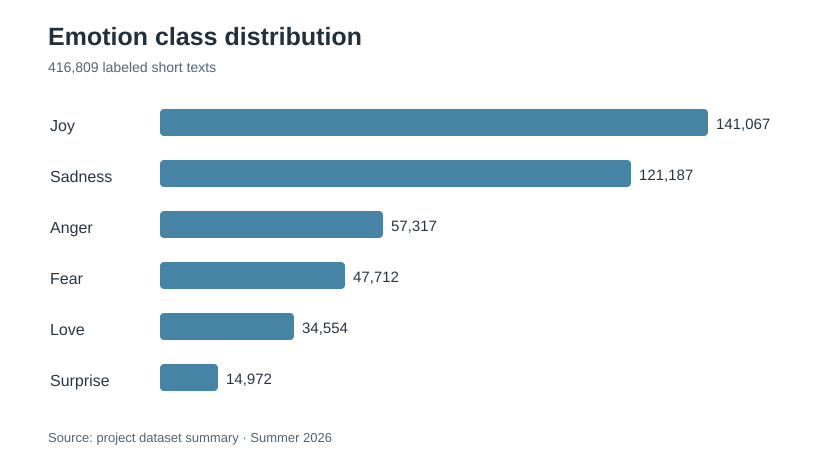
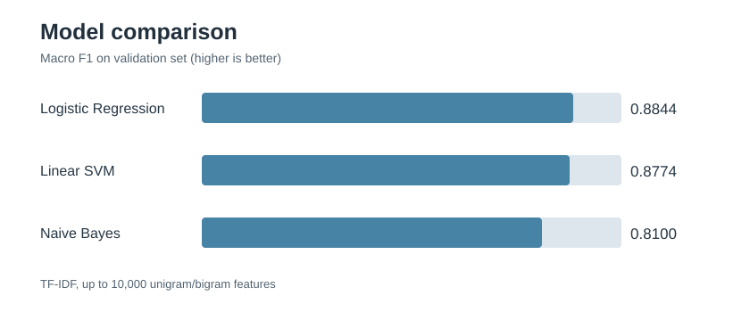

# Emotion Classification Using Text

**Alaina Liu · CalCyAIVR Institute, Cal Poly Pomona · Summer 2026**

## Overview

How accurately can a machine-learning model identify emotions in short written messages? For this research project, I analyzed **416,809 labeled text samples** spanning **anger, fear, joy, love, sadness, and surprise**. I developed a text preprocessing and TF-IDF pipeline, trained three standard machine-learning classifiers, and compared their results, including errors in less frequent emotion categories.

### Key findings

| Measure | Result |
| --- | --- |
| Dataset | 416,809 labeled texts |
| Classes | Six emotions |
| Models | Naive Bayes, Logistic Regression, Linear SVM |
| Feature representation | TF-IDF (up to 10,000 unigrams and bigrams) |
| Best validation model | Logistic Regression |
| Final test accuracy | Approximately **91%** |
| Final test macro F1 | Approximately **0.88** |

## Research question and motivation

Short online messages contain valuable emotional information but often lack context and have overlapping language. This project asked whether traditional machine-learning techniques could distinguish six emotions reliably, and what their misclassifications reveal about the limitations of text-only emotion recognition.

The work connects NLP with questions about online communication, social behavior, and the responsible interpretation of predictive models.

## Exploratory data analysis

The prepared dataset contains **333,447 training, 41,681 validation, and 41,681 test** examples. The six emotion classes are imbalanced: **joy and sadness make up about 62.9%**, while **surprise represents only 3.6%**. This made macro F1 an important evaluation metric in addition to accuracy.

The notebook includes data exploration, class distributions, preprocessing, model evaluation and error analysis.

## Modeling pipeline

1. Inspect the dataset, class distributions, missing values and message lengths.
2. Clean short texts by lowercasing and removing URLs, usernames, punctuation, digits, stop words, and other noise.
3. Represent cleaned text using **TF-IDF** with up to 10,000 unigram/bigram features.
4. Train and compare **Multinomial Naive Bayes**, **Logistic Regression**, and **Linear SVM** using validation metrics.
5. Select the strongest model on **validation macro F1**, then evaluate on the held-out test split.

## Results

### Validation results

| Model | Accuracy | Macro F1 | Weighted F1 |
| --- | ---: | ---: | ---: |
| **Logistic Regression** | **0.9162** | **0.8844** | **0.9186** |
| Linear SVM | 0.9149 | 0.8774 | 0.9167 |
| Naive Bayes | 0.8827 | 0.8100 | 0.8763 |

Logistic Regression produced the strongest validation macro F1.

### Final test evaluation

The selected model achieved approximately **91% accuracy**, **0.88 macro F1** and **0.92 weighted F1**. Per-class test F1 scores were:

| Emotion | F1 |
| --- | ---: |
| Anger | 0.92 |
| Fear | 0.87 |
| Joy | 0.93 |
| Love | 0.84 |
| Sadness | 0.95 |
| Surprise | 0.79 |

Common errors included **joy → love (1,059 examples)**, **sadness → anger (375)** and **fear → surprise (366)**. These mistakes help explain why interpreting short texts is harder than obtaining a single high accuracy score suggests.

## Limitations and implications

Text classifiers recognize statistical patterns, not people's inner experiences. Emotions can overlap, class imbalance can affect smaller categories, and sarcasm or cultural context may be missing. This system should therefore be used as an exploratory research tool rather than a standalone basis for decisions about individuals.

## Research materials

| Resource | Description |
| --- | --- |
| [Jupyter notebook](Emotion_Research_Alaina.ipynb) | Research code with saved outputs, models, and error analysis |
| [Research report](research_report.md) | Full methods, validation and test results, ethical limitations, and future work |
| [Dataset instructions](data/README.md) | Required CSV structure and source-data handling |
| [Requirements](requirements.txt) | Python dependencies |

## Run this research

Download or clone this repository and install the packages in `requirements.txt`. Place an **authorized copy** of the prepared CSV at `data/twitter_emotion.csv`, then execute the Jupyter notebook. The public repository does not host the raw texts, and Google Colab requires uploading the dataset to its runtime before rerunning.

## Future work

Potential extensions include classifier tuning, alternative n-gram settings, independent-dataset evaluation, transformer comparisons and fairness analysis across writing styles.

---

*This project is documented independently of any unconfirmed conference acceptance or paper publication.*
